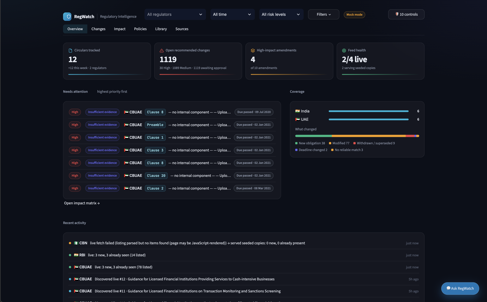
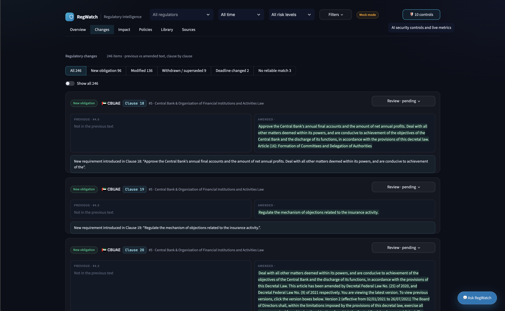
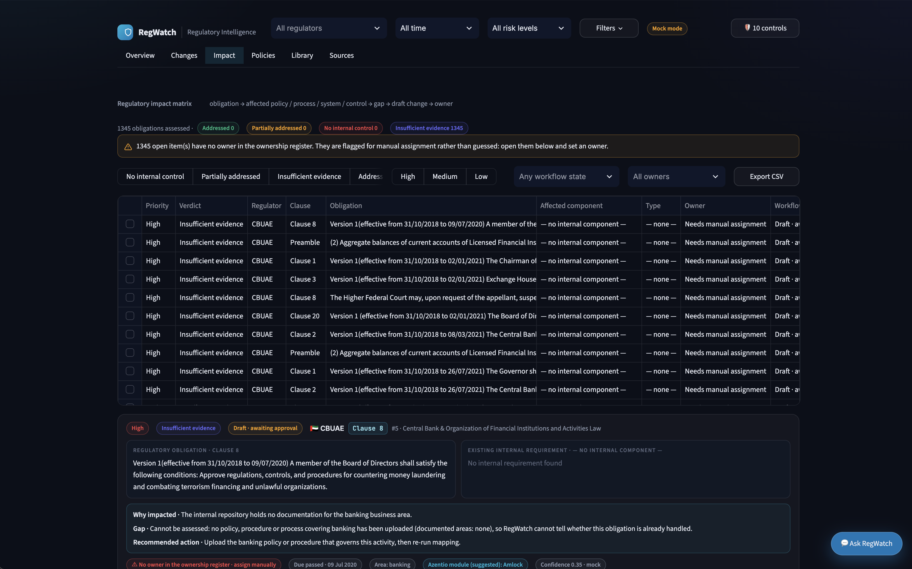
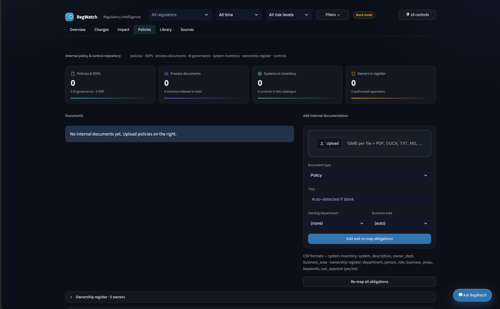
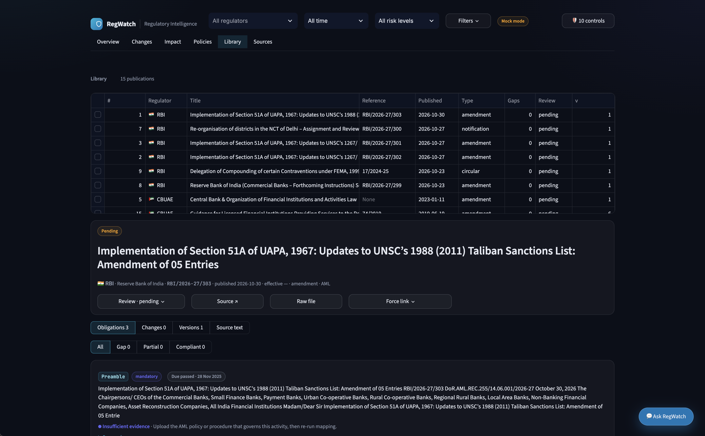
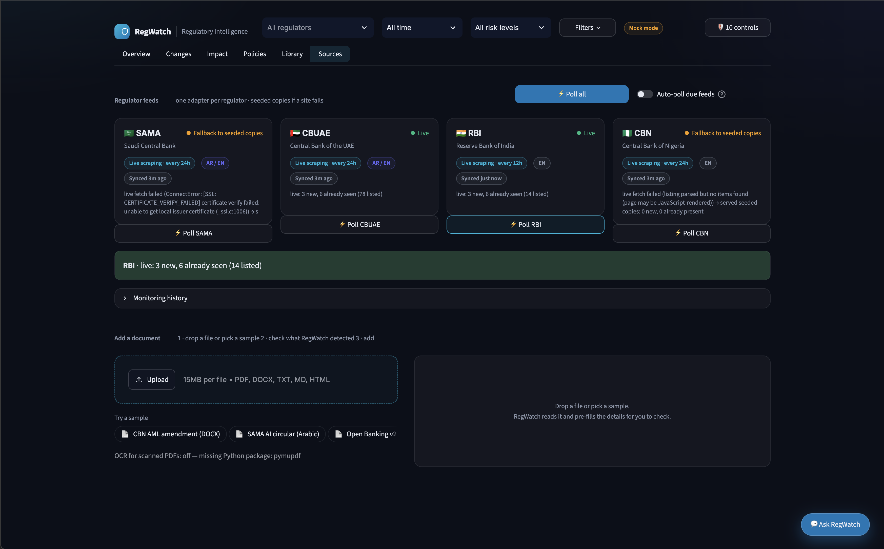
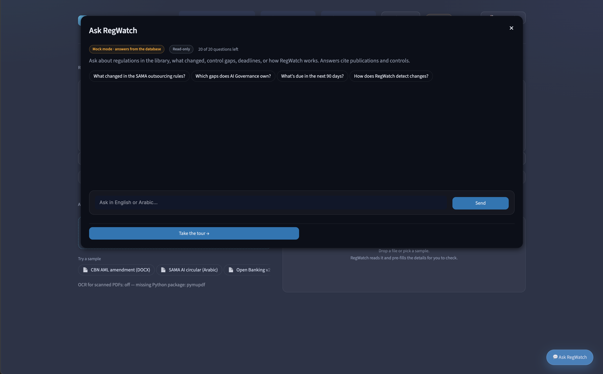

# RegWatch — Regulatory Change Impact Agent

A Streamlit app that does four things:

- **Monitors** regulators in four regions.
- **Extracts** each publication's obligations, with clause references.
- **Compares** each new publication with earlier ones, clause by clause.
- **Checks controls**, like a Vanta questionnaire: it asks whether the organisation's existing control set
  already satisfies each new obligation.

Everything is on a filterable dashboard with human review. See the [Product tour](#product-tour) for
annotated screenshots of every section.

| Region | Regulator | Live monitoring today | If live fails |
| --- | --- | --- | --- |
| India | RBI | Works: classic notifications list → HTML notice pages | seeded copies, run marked `partial` |
| UAE | CBUAE | Works: rulebook landing → sector pages → regulation pages | seeded copies, run marked `partial` |
| KSA | SAMA | Site currently fails TLS verification | seeded copies, run marked `partial` |
| Nigeria | CBN | Listing is JavaScript-rendered, so the parse comes back empty | seeded copies, run marked `partial` |

## Quick start

```bash
python -m venv .venv
```

```bash
.venv/Scripts/python -m pip install -r requirements.txt
```

```bash
.venv/Scripts/python -m streamlit run app.py
```

(On macOS/Linux use `.venv/bin/python`.) The database is built from the samples on first launch.

Run the tests (35, all offline: they never call the model, even with a key in .env):

```bash
.venv/Scripts/python -m pytest -q
```

### One model: `google/gemma-4-31b-it:free`

One free model handles all three LLM jobs: obligation extraction, clause pairing and classification, and the
control-impact Q&A.

- **Why this model:** 262K context for long circulars, tool calling, JSON mode, and Arabic + English
  (needed for SAMA/CBUAE).
- **No second model:** retrieval is TF-IDF, so there's no embedding model.
- **Configuration:** set in `config/llm.yaml`, with one fallback slug (`google/gemma-4-26b-a4b-it:free`).
  The fallback is used only if the primary is rate-limited or unavailable mid-demo.
- **Structured output:** the free Gemma endpoints don't support strict `json_schema`. RegWatch forces a
  function call whose parameters are the schema (`response_mode: tools`), then falls back to JSON mode.
- **Turning it on:** copy `.env.example` to `.env` and set `OPENROUTER_API_KEY`. Then click
  **Sources & upload → Maintenance → Re-run**.
- **Without a key:** the app runs in **mock mode**, using deterministic rules that still produce structured,
  clause-referenced output and control assessments.

### Live mode, quota and cost

**Free-tier quota:** OpenRouter free models allow **50 requests per day** without credits, or 1,000 per day
after adding $10 of credits. When the daily quota runs out:
- RegWatch stops calling the model until the reset time.
- The header shows "Live · quota used until HH:MM".
- Cached answers keep working, and new items use the rule-based fallback, labelled `mock (LLM failed)`.

**Keeping comparisons cheap:**
- **Hashing:** a re-uploaded or re-fetched file with the same SHA-256 is never processed again.
- **Changed clauses only:** clauses that are word-for-word identical in both versions are dropped before the
  model sees them. For the sample amendments that's about 350 tokens instead of the two full documents, and
  nothing at all when no clause changed.
- **Caching:** every model answer is cached by content.

**Check the live model end to end** (about 6 requests, run on a scratch copy of the database):

```bash
.venv/Scripts/python -m regwatch.live_check
```

**Scheduled fetching.** Each regulator has an `interval_hours` in `config/sources.yaml`. Run the scheduler
as a background process, or once from cron or Windows Task Scheduler:

```bash
.venv/Scripts/python -m regwatch.scheduler --every 15
```

```bash
.venv/Scripts/python -m regwatch.scheduler --once
```

**Upload checks.** Wrong files are refused with a reason; try the sample buttons under **Sources → Add a
document**.
- **Rejected:** a text file renamed to `.pdf`, a corrupt PDF, or a PDF with embedded or active content.
- **Flagged as not regulatory:** valid files with no obligation language or regulatory vocabulary (for
  example a menu, or a scanned image without OCR). Adding them anyway needs an explicit confirmation.
- **Test files:** regenerate them with `python data/samples/upload_demo/make_test_pdfs.py`.

### OCR (optional)

Scanned PDFs are read with Tesseract when it's installed (`pytesseract` and `pymupdf` are already in
`requirements.txt`). On Windows:

```bash
winget install UB-Mannheim.TesseractOCR
```

Each publication records `ocr_used` and `extraction_quality` (good / ocr / low / image_only_no_ocr). When OCR
isn't available, scanned files are flagged for manual review rather than silently returning nothing.

## Product tour

Screenshots of the running app, one per section of the top navigation. The header (regulator, time range and
risk filters) and the **Ask RegWatch** button stay visible everywhere; the badge next to the filters shows
whether the app is in **Mock mode** or **Live**.

### Overview



The landing page answers "what needs my attention right now?".

- **Four KPIs:** circulars tracked, open recommended changes (with a high/medium split and an
  awaiting-approval count), high-impact amendments, and feed health for the current monitoring run.
- **Needs attention** lists the highest-priority open items first, with verdict, regulator, clause and due
  date, so the worst gap is always at the top. Clicking through opens the impact matrix.
- **Coverage** shows tracked publications per jurisdiction and a **What changed** breakdown: new obligation,
  modified, withdrawn/superseded, deadline changed, and no reliable match.
- **Recent activity** is the monitoring log in plain language — which feeds polled live, what was already
  seen, and which regulator fell back to seeded copies.

### Changes



Every amended publication is broken into individual clause changes, with a filter chip per change type
(all, new obligation, modified, withdrawn/superseded, deadline changed, no reliable match) and a "show all"
toggle.

- Each card carries the verdict, the regulator, the clause number and the instrument title, plus a
  **Review** dropdown to record the human decision.
- Previous and amended text sit **side by side**, with red/green highlighting, and a plain-language sentence
  below states what the change actually requires.
- Because changes are stored per clause, an amending circular records all of its changes rather than a single
  document-level "changed" flag.

### Impact



The Level 2 impact matrix: obligation → affected policy / process / system / control → gap → draft change →
owner.

- A counter strip shows how many obligations were assessed and how they split across addressed, partially
  addressed, no internal control and insufficient evidence.
- Anything with no owner in the ownership register is flagged for manual assignment rather than guessed —
  the banner counts them and links to the rows.
- The matrix is filterable by verdict, priority, workflow state and owner, and exports to Jira-ready CSV.
- Expanding a row shows the regulatory obligation next to the **existing internal requirement** (quoted
  verbatim), then *why impacted*, the **gap**, the **recommended action**, the owning area, suggested
  delivery module and a confidence score.

### Policies



The internal policy and control repository that impact analysis reasons over. The app never connects to a
device, server or scanner.

- KPI cards summarise policies and SOPs, process documents, systems in inventory and authorised owners.
- **Add internal documentation** accepts PDF, DOCX, TXT and Markdown up to 15 MB per file, with an optional
  title, owning department and business area. Submitting runs **Add and re-map obligations**.
- CSV uploads cover the system/application inventory and the ownership register; the expected columns are
  listed under the form.
- **Re-map all obligations** re-runs the mapping after the repository changes, and existing owner and
  review decisions are preserved.

### Library



The regulatory library itself — every monitoring run and upload lands here.

- The publication table lists regulator, title, reference, publication date, type, open gaps, review state
  and version.
- Selecting a publication opens its detail panel with the full title, status, metadata (reference,
  published/effective dates, type, category) and four actions: **Review**, **Source**, **Raw file** and
  **Force link**.
- Sub-views split the record into **Obligations**, **Changes**, **Versions** and **Source text**, and the
  obligations can be filtered by control-check outcome: all, gap, partial or compliant.
- Each obligation keeps its clause reference, type (mandatory, prohibition, clarification, definition), due
  date and control-check verdict, so a reviewer can trace from summary back to the exact source clause.

### Sources



Feed health and ingestion in one place.

- One card per regulator (SAMA, CBUAE, RBI, CBN) with its live / fallback state, polling cadence, languages,
  last sync time and the result of the most recent fetch.
- **Poll all**, **Auto-poll due feeds** and a per-regulator **Poll** button run monitoring on demand; anything
  that fails is retried and then served from seeded copies for that cycle.
- **Monitoring history** keeps every run with its `ok` / `partial` / `error` status.
- **Add a document** is the manual path: drop a file or use a sample (CBN AML amendment, SAMA AI circular in
  Arabic, Open Banking v2), review what RegWatch detected, then add it. Files are validated and duplicates
  are caught by hash; the OCR status is shown here too.

### Ask RegWatch



A read-only assistant available from every screen via the floating button.

- Answers questions about what changed, which gaps a policy owns, what is due in the next 90 days, or how
  RegWatch itself works, citing publications and controls.
- Suggested questions give a one-click starting point; the input accepts **English or Arabic**.
- Each session is capped by a question counter, and the badge shows whether answers come from the database
  (mock mode) or the live model.
- **Take the tour** launches the guided walkthrough of the app.

The companion **AI security** panel is also reachable from every screen (the shield button in the header) and
has four sub-views: controls, a prompt-injection playground, flagged documents and the LLM audit log.

## What's in the box

```text
app.py                    Streamlit dashboard (6 sections + header filters, assistant and AI-security dialogs)
config/
  sources.yaml            the 4 sources: URLs, allowed hosts, polling interval
  llm.yaml                model + fallback slug + structured-output mode
  controls.yaml           the control library (answered questions), loaded into the `control` table
regwatch/
  adapters/               one adapter per regulator (rbi.py, cbuae.py, sama.py, cbn.py) + base.py
  monitor.py              runs adapters; on 403/timeout/empty parse serves seeded copies, run = partial
  ingest.py               PDF / DOCX / HTML / text -> text + clause map; Tesseract OCR fallback; Arabic digits
  extract.py              obligations (LLM via function calling, or rules; English + Arabic)
  compare.py              prior retrieval (version, cross-ref, TF-IDF), LLM clause pairing, force link
  assess.py               control-impact Q&A: compliant / partial / gap + control to update
  pipeline.py             validate -> store -> ingest -> extract -> version -> compare -> assess
  llm.py                  OpenRouter: one model + fallback, tools/json modes, cache, audit log
  security.py             prompt-injection scan, sanitising, PII redaction, grounding, upload + SSRF guards
  db.py, ui.py, seed.py   schema, glass UI components, sample loader
tests/                    adapter tests (offline fixtures) + pipeline tests
data/samples/             8 illustrative circulars + manifest; upload_demo/ has 4 demo files
```

The sample circulars are **illustrative**, written in each regulator's format with `ILLUS` reference
numbers. They are not official publications.

## How it works

**1. Monitoring (reliable by design).** Each regulator has its own adapter. An adapter's `parse()` is pure,
so it is tested offline against fixtures.

- Every cycle writes a `monitoring_run` row with status `ok`, `partial` or `error`.
- If live retrieval fails (HTTP 403, timeout, TLS error, empty parse), the adapter serves that regulator's
  seeded copies from `data/samples/` and marks the run `partial`, so the demo never stalls.
- Duplicates are caught twice: by URL before download, then by SHA-256 hash after.

**2. Document understanding.** Each obligation is stored with:

- its `clause_ref` and type (mandatory / prohibition / clarification / definition);
- who it applies to, any deadline, a confidence score and a grounding score.

The detail view shows the verbatim source clause next to each obligation. Arabic circulars are supported:
Arabic-Indic digits, المادة/البند labels, Arabic modal verbs, and right-to-left rendering.

**3. Clause-level comparison.**

- **Finding the prior:** a new publication is matched to its previous **version** first, then to an
  instrument whose **reference number it cites**, then by TF-IDF similarity.
- **Pairing clauses:** in live mode the model pairs prior clauses with new clauses (even when renumbered)
  and classifies each pair. Clause text is always copied from the documents, never from model output.
- **Storage:** each comparison has one `comparison_clause` row per change, so an amending circular records
  all its changes.
- **Highlighting:** `difflib` is used only in the UI, for red/green highlighting.
- **No match:** when auto-match returns `no_reliable_match`, a reviewer uses **Force link with prior
  circular** on the Document tab.

**4. Versions.** A new content hash for an existing document group (same regulator + reference number)
becomes **v2**. Earlier versions are kept, never overwritten, and v2 is compared with v1 automatically.

## Level 2 — impact assessment and recommended changes

The app never connects to a device, server or scanner: it reasons over the organisation's documentation.

**1. Internal policy and control repository** (**Policies** section, `regwatch/internal.py`). Upload:

| Document type | Format |
| --- | --- |
| Policies and SOPs | PDF / DOCX / TXT |
| Business process documents | PDF / DOCX / TXT |
| AI governance policies | PDF / DOCX / TXT |
| System / application inventory | CSV: `system, description, owner_dept, business_area` |
| Ownership and responsibility register | CSV: `department, person, role, business_areas, keywords, can_approve` |
| Control catalogue | edited in the app (seeded from `config/controls.yaml`) |

- Each document is split into numbered sections, so findings quote exact internal text.
- Uploads are validated, duplicates are detected by hash, and a changed document becomes a new version.
- Adding a document re-maps every obligation.
- Demo data lives in `data/samples/internal/`. It describes a fictional bank and fictional people.

**2. Regulation-to-internal mapping** (`regwatch/assess.py`). For each obligation, RegWatch finds the affected
policies, SOPs, processes, systems and controls (TF-IDF candidates; the live model or rules judge each).
Each impact-matrix row (`policy_mapping`) records:
- the obligation and the affected component;
- why it is impacted;
- the existing internal requirement (verbatim);
- the gap;
- the recommended action;
- proposed wording;
- business area and priority;
- confidence and references.

Example from the demo data: the CBUAE AI amendment's human-review requirement for automated credit
declines maps to:

| Component | Verdict | Why |
| --- | --- | --- |
| Credit Decisioning Policy §3.2 | partial | reviews declines "only if the customer appeals" |
| AI Model Governance Policy §5.1 | partial | human review is "on a sample basis" |
| Control AIG-05 | partial | reviews only on appeal |

Each comes with draft wording that requires human review before a decline and keeps the decision and the
reviewer's identity in the audit trail.

**3. Gap analysis: four outcomes per obligation.**

| Outcome | Meaning | Demo count |
| --- | --- | --- |
| Addressed | an internal requirement fully covers it, including numbers and dates | 31 |
| Partially addressed | the topic is covered but something is missing or different, e.g. 30 vs 60 days, a date, a condition | 8 |
| No internal control | the business area is documented, but nothing requires this | 6 |
| Insufficient evidence | no documentation exists for that business area (or Arabic text in mock mode), so no determination is made | 3 (open banking / payments) |

Every gap explains what is missing and why the existing text is insufficient.

**4. Recommended changes.**
- **Specific, not generic.** For example: "Replace POL-OUT-03 Clause 5.1 with: *Compliance notifies SAMA at
  least 60 days before…*".
- **Linked** to the regulatory clause, business area and priority.
- **Drafts until approved.** They stay drafts until an **authorised approver** from the ownership register
  approves them. The wording can be edited while it's a draft.

**5. Impact matrix** (**Impact** section). It can be filtered by verdict, priority, workflow and owner, and
exported as Jira-ready CSV or a per-item ticket.

**6. Ownership and actions.**
- **Owners** come only from the ownership register; RegWatch never guesses a person. Items with no match
  are flagged **Needs manual assignment** (3 in the demo).
- **Reviewers** confirm or change the owner, set a deadline, and record implementation status (not started →
  in progress → implemented → verified) once a change is approved.
- **Re-mapping** after new documents or regulations keeps these decisions.

**Dashboard sections:**

| Section | Shows |
| --- | --- |
| Overview | KPIs, needs-attention list, coverage, activity |
| Changes | side-by-side clause changes |
| Impact | the Level 2 impact matrix, approvals, owners |
| Policies | the internal repository, ownership register and control catalogue |
| Library | publications, obligations, versions, comparison, force link |
| Sources | regulator feeds and upload |

The 💬 **Ask RegWatch** assistant, the guided tour and the 🛡️ AI-security panel are available on every
screen. See [Product tour](#product-tour) for annotated screenshots of each section.

## AI / LLM security

Documents are untrusted input. The controls live in `regwatch/security.py` and appear on the AI security tab:

- **Prompt injection:** documents are scanned for injection attempts and hidden characters, then sanitised
  and fenced off with a guardrail prompt.
- **Output checks:** structured output is validated and checked for grounding.
- **Privacy:** PII is redacted before any LLM call.
- **Display safety:** everything shown on the dashboard is HTML-escaped.
- **Input safety:** uploads are validated, and scrapers are limited to allowed hosts (SSRF guard).
- **Limits and audit:** cost caps, and an audit log of every LLM call (hashes only).
- **Access:** an optional password gate.

## 5-minute demo

1. **Overview:** four jurisdictions, amendments, control gaps, 1 "could not match".
2. **Sources & upload → Run monitoring now** (all sources). RBI and CBUAE pull real items live; SAMA and CBN
   fall back to seeded copies, shown as `partial`.
3. **Changes:** the SAMA outsourcing amendment shows all 5 clause changes (deadline moved to 31 Dec 2026,
   30 → 60 days, withdrawn offshore clause, new cloud-concentration rule).
4. **Control impact:** the same amendment yields *partial OUT-04 (30 → 60 days)*, *partial OUT-02
   (deadline)* and a *gap* for cloud concentration. Edit OUT-04's answer to 60 days, click save, and watch
   it turn compliant.
5. **Upload** `upload_demo/cbn_open_banking_2026_v2.txt`. It becomes **v2** of the Open Banking guideline,
   with the go-live date change detected.
6. **Document → CBN Open Banking v1:** it shows "no reliable match". Use **Force link** to compare it with
   a chosen prior.
7. **Arabic:** upload `upload_demo/sama_ai_circular_ar.txt`. Its 5 obligations are extracted, including a
   prohibition and the 31/03/2027 deadline.
8. **AI security:** upload `upload_demo/suspicious_consultation.txt`. The injection is flagged and
   discarded, and the PII is redacted.

Reset to the clean demo state at any time:

```bash
.venv/Scripts/python -m regwatch.seed --reset
```

## Known limits

- Free-tier OpenRouter models are rate-limited. The fallback slug helps, and every response is cached, so a
  rehearsed demo replays from cache.
- Mock mode can't match Arabic obligations to the English control library; live Gemma can, because it reads
  both languages.
- OCR needs the Tesseract binary (see above). Without it, scanned PDFs are flagged, not read.
- RBI PDFs are served from a host that may refuse automated downloads, so RBI's HTML notice page (same text)
  is used instead.
